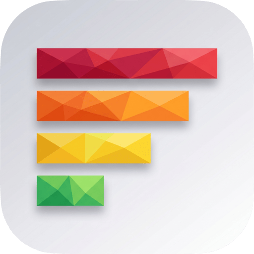
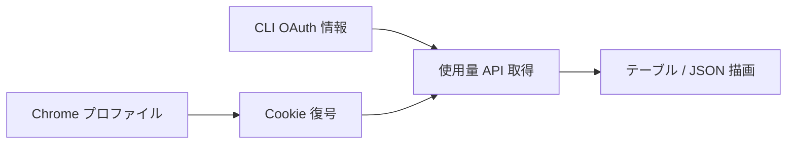

<p align="center">
  
</p>

<h1 align="center">ai-usage</h1>

<p align="center">
  サインイン済みの全 Chrome プロファイルと CLI の OAuth アカウントについて、Claude / Codex / Antigravity / PixelLab / Grok の使用量をまとめて表示する macOS 向け CLI
</p>

<!-- standard:badges:start -->
<h3 align="center">対応プラットフォーム</h3>

<p align="center">
  
</p>

<p align="center">
  <a href="https://github.com/owayo/ai-usage/actions/workflows/ci.yml"></a>
  <a href="https://github.com/owayo/ai-usage/releases/latest"></a>
  <a href="LICENSE"></a>
</p>

<p align="center">
  <a href="README.md">English</a> |
  <a href="README.ja.md">日本語</a>
</p>
<!-- standard:badges:end -->

---

**Claude** / **OpenAI Codex (ChatGPT)** / **Antigravity** / **PixelLab** / **Grok** の使用量を1コマンドでまとめて表示する macOS 向け CLI です。ブラウザ認証のアカウントはサインイン済みの Chrome プロファイルを横断し、Antigravity と Grok は CLI の OAuth 情報から取得します。

各 Chrome プロファイルのセッションをブラウザから直接読み取るため、ログインし直すことなく **複数アカウントを同時に**確認できます(例: `Work` と `Home` の2プロファイル × Claude/Codex のサブスク = 4アカウント)。

## 機能

- **マルチアカウント**: サインイン済みの全 Chrome プロファイルを一覧表示。ログインし直し不要。表示名はプロバイダのメール、Chrome プロファイルのメール、プロファイル名の順に解決し、空値や `@` の欠落・重複を含む不正なメールは読み飛ばす
- **マルチプロバイダ**: Claude (`claude.ai`) / Codex (`chatgpt.com`) / Antigravity (Google `agy` CLI・IDE) / PixelLab (`pixellab.ai`) / Grok (xAI `grok` CLI) を同一ビューに集約
- **型付き利用枠**: 各 quota が 5 時間・日次・週次・月次の実周期を保持し、取得できた利用率とリセット残時間を表示。利用率が不明な場合は 0% とせず `--%` を表示。行内バッジ (`5h` / `1d` / `1w` / `1m`) は quota 自身の周期から決定。利用枠が1つだけの行は 2 つのスロットを 1 本の横長バーに統合。周期情報がない旧キャッシュでも、プロバイダーに応じたラベルとリセット警告色を維持
- **手動リセット**: Claude と Codex の行に、手動リセットの残回数と付与分ごとの有効期限を表示。テーブルと TUI は期限ごとの内訳を、statusline は合計と直近の期限を示す。statusline と TUI では、残り7日未満の期限を赤で表示。取得できなかった回数は `0` ではなく `?` と表示し、期限切れの付与分は古いキャッシュを描画するときも除外
- **Cloudflare 対応**: [`wreq`](https://crates.io/crates/wreq) が Chrome の TLS/HTTP2 フィンガープリントをエミュレートし、`cf_clearance` を再送
- **statusline モード**: 端末のステータスバー向けにアカウント 1 行のコンパクト表示。ブランドロゴ字形にも対応。ラベルは表示幅で揃え、絵文字や結合文字を途中で切らずに短縮
- **対話式ダッシュボード**: `--tui` で利用枠と手動リセットをアカウントごとに表示し、画面下部の欄に起動ディスクの使用済み・パージ可能・空きの容量を表示。高さの低い端末でもアカウントの見える部分を描き、リセットまで残り1〜59秒は `1m` と表示
- **ディスク容量の出力**: `--disk` でディスク欄と同じ行を1ボリューム1行で表示し、`--disk --json` でスクリプト向けにバイト単位の値を出力。Chrome・Keychain・ネットワーク・使用量のキャッシュには触れない
- **JSON 出力**: スクリプト・ダッシュボード向けの機械可読出力
- **設定不要**: サインイン済みプロファイルを自動検出。固定したい場合のみ `~/.config/ai-usage/config.toml`
- **ソート**: 長期枠の利用率、またはリセット時刻でランキング (`weekly-*` のオプション名は互換性のため維持)
- **プライバシー**: 対応プロバイダへの認証付き使用量リクエスト以外は外部に出さない

## 動作環境

- **ブラウザ**: ブラウザ認証プロバイダ用の Google Chrome (Claude / Codex / PixelLab にサインイン済み)。下記の OAuth 認証プロバイダのみを使う場合は Chrome は不要 — 見つからない場合はその旨を stderr に出し、残りのプロバイダを表示する
- **ソースからのビルド**: [`wreq`](https://crates.io/crates/wreq) の BoringSSL のビルドには Rust と CMake が必要。`make setup` が `mise.toml` の固定版を導入します。直接 `cargo install` する場合は CMake を `PATH` に用意してください (例: `brew install cmake`)
- **任意**: Antigravity 使用量には Antigravity.app、`agy` CLI、または `~/.gemini` の OAuth トークンが必要。トークン更新にはアプリの OAuth クライアント情報、または [動作の仕組み](docs/architecture.ja.md) に記載した環境変数も必要
- **任意**: Grok 使用量には `grok` CLI にサインイン済み (`~/.grok/auth.json`) が必要

## インストール

<!-- standard:install:start -->
### Homebrew (macOS)

```bash
brew install owayo/ai-usage/ai-usage
```

### Cargo

Rust 1.98 以上が必要です。

```bash
cargo install --git https://github.com/owayo/ai-usage --locked
```

### GitHub Releases から

[Releases](https://github.com/owayo/ai-usage/releases/latest) から自分の環境のアーカイブを取得して展開し、`ai-usage` を `PATH` の通った場所に置きます。各リリースには、取得したファイルを確かめるための `SHA256SUMS` も添付しています。

| プラットフォーム | ファイル |
|---|---|
| macOS (Intel) | `ai-usage-x86_64-apple-darwin.tar.gz` |
| macOS (Apple Silicon) | `ai-usage-aarch64-apple-darwin.tar.gz` |

macOS でブラウザから取得した場合は、実行の前に隔離属性を外します: `xattr -d com.apple.quarantine ai-usage`。

### ソースから

[mise](https://mise.jdx.dev/) が必要です (Rust のツールチェーンは `mise.toml` で固定しています)。

```bash
git clone https://github.com/owayo/ai-usage.git
cd ai-usage
make install
```

`make install` は `/usr/local/bin` に入れます。場所を変えるときは `INSTALL_PATH` を指定します (例: `make install INSTALL_PATH="$HOME/.local/bin"`)。
<!-- standard:install:end -->

### 初回の実行

ブラウザ認証のプロバイダから初めて使用量を取得するときは、macOS の Keychain ダイアログ (*「"Chrome Safe Storage" キーを使用しようとしています」*) が出ます。**「常に許可」** を選んでください。

## 使い方

取得結果は既定で120秒間、プロセス間で共有します。複数の画面やコマンドを同時に起動しても、同じ取得元への問い合わせは1回にまとめます。キャッシュが有効な間はAPI通信とChrome用のKeychain参照を省きます。すぐに更新するには `ai-usage --refresh`、保存期間を変えるには `--cache-ttl 60` を指定してください。詳しくは[共有キャッシュ](docs/cli-reference.ja.md#共有キャッシュ)を参照してください。

引数なしで `ai-usage` を実行すると、サインイン済みの全アカウントを表示します。

```text
┌─────────┬──────────┬──────────────────────────┬─────────────────────────────────┬───────────────────────────────────────────────┬───────────────────────────────────────┐
│ Account ┆ Service  ┆ Plan                     ┆ Short window                    ┆ Long window                                   ┆ Manual resets                         │
╞═════════╪══════════╪══════════════════════════╪═════════════════════════════════╪═══════════════════════════════════════════════╪═══════════════════════════════════════╡
│ work    ┆ Claude   ┆ max                      ┆ 5h ░░░░░░░░░░    4%  · in 2h 0m ┆ 1w ░░░░░░░░░░    3%  · in 4d 0h               ┆ full 1 (1@10/23 05:27)                │
│         ┆          ┆                          ┆                                 ┆                                               ┆ 5h 0                                  │
├╌╌╌╌╌╌╌╌╌┼╌╌╌╌╌╌╌╌╌╌┼╌╌╌╌╌╌╌╌╌╌╌╌╌╌╌╌╌╌╌╌╌╌╌╌╌╌┼╌╌╌╌╌╌╌╌╌╌╌╌╌╌╌╌╌╌╌╌╌╌╌╌╌╌╌╌╌╌╌╌╌┼╌╌╌╌╌╌╌╌╌╌╌╌╌╌╌╌╌╌╌╌╌╌╌╌╌╌╌╌╌╌╌╌╌╌╌╌╌╌╌╌╌╌╌╌╌╌╌┼╌╌╌╌╌╌╌╌╌╌╌╌╌╌╌╌╌╌╌╌╌╌╌╌╌╌╌╌╌╌╌╌╌╌╌╌╌╌╌┤
│ work    ┆ Codex    ┆ team                     ┆ 5h ░░░░░░░░░░    1%  · in 5h 0m ┆ 1w ░░░░░░░░░░    0%  · in 6d 23h              ┆ full 2 (1@10/23 05:27, 1@10/30 03:57) │
├╌╌╌╌╌╌╌╌╌┼╌╌╌╌╌╌╌╌╌╌┼╌╌╌╌╌╌╌╌╌╌╌╌╌╌╌╌╌╌╌╌╌╌╌╌╌╌┼╌╌╌╌╌╌╌╌╌╌╌╌╌╌╌╌╌╌╌╌╌╌╌╌╌╌╌╌╌╌╌╌╌┼╌╌╌╌╌╌╌╌╌╌╌╌╌╌╌╌╌╌╌╌╌╌╌╌╌╌╌╌╌╌╌╌╌╌╌╌╌╌╌╌╌╌╌╌╌╌╌┼╌╌╌╌╌╌╌╌╌╌╌╌╌╌╌╌╌╌╌╌╌╌╌╌╌╌╌╌╌╌╌╌╌╌╌╌╌╌╌┤
│ home    ┆ Claude   ┆ max                      ┆ 5h █░░░░░░░░░   12%  · in 1h 0m ┆ 1w ░░░░░░░░░░    3%  · in 5d 0h               ┆ full 0                                │
│         ┆          ┆                          ┆                                 ┆                                               ┆ 5h 0                                  │
├╌╌╌╌╌╌╌╌╌┼╌╌╌╌╌╌╌╌╌╌┼╌╌╌╌╌╌╌╌╌╌╌╌╌╌╌╌╌╌╌╌╌╌╌╌╌╌┼╌╌╌╌╌╌╌╌╌╌╌╌╌╌╌╌╌╌╌╌╌╌╌╌╌╌╌╌╌╌╌╌╌┼╌╌╌╌╌╌╌╌╌╌╌╌╌╌╌╌╌╌╌╌╌╌╌╌╌╌╌╌╌╌╌╌╌╌╌╌╌╌╌╌╌╌╌╌╌╌╌┼╌╌╌╌╌╌╌╌╌╌╌╌╌╌╌╌╌╌╌╌╌╌╌╌╌╌╌╌╌╌╌╌╌╌╌╌╌╌╌┤
│ home    ┆ Codex    ┆ prolite                  ┆ 5h █░░░░░░░░░   10%  · in 4h 0m ┆ 1w ███░░░░░░░   31%  · in 4d 0h               ┆ full 0                                │
├╌╌╌╌╌╌╌╌╌┼╌╌╌╌╌╌╌╌╌╌┼╌╌╌╌╌╌╌╌╌╌╌╌╌╌╌╌╌╌╌╌╌╌╌╌╌╌┼╌╌╌╌╌╌╌╌╌╌╌╌╌╌╌╌╌╌╌╌╌╌╌╌╌╌╌╌╌╌╌╌╌┼╌╌╌╌╌╌╌╌╌╌╌╌╌╌╌╌╌╌╌╌╌╌╌╌╌╌╌╌╌╌╌╌╌╌╌╌╌╌╌╌╌╌╌╌╌╌╌┼╌╌╌╌╌╌╌╌╌╌╌╌╌╌╌╌╌╌╌╌╌╌╌╌╌╌╌╌╌╌╌╌╌╌╌╌╌╌╌┤
│ home    ┆ PixelLab ┆ Tier 1: Pixel Apprentice ┆ —                               ┆ 1m ███████████░░░░░░░░░░░░░   46%  · in 5d 0h ┆ —                                     │
└─────────┴──────────┴──────────────────────────┴─────────────────────────────────┴───────────────────────────────────────────────┴───────────────────────────────────────┘
  updated 21:46 · bars = usage, time = until reset
```

**Manual resets** 列は、Claude または Codex の行が手動リセットの情報を返したときに表示されます。表記は [手動リセットの残回数と有効期限](docs/cli-reference.ja.md#手動リセットの残回数と有効期限) を参照してください。

```bash
# 基本的な使い方
ai-usage                          # 全プロファイル・全プロバイダ
ai-usage -p Work,Home             # プロファイル指定
ai-usage --list-profiles          # 検出した Chrome プロファイルの一覧

# プロバイダ絞り込み
ai-usage --only claude
ai-usage --only codex
ai-usage --only antigravity
ai-usage --only pixellab
ai-usage --only grok

# JSON 出力 (スクリプト向け)
ai-usage --json

# 対話式の端末画面
ai-usage --tui
ai-usage --tui --only codex
ai-usage --tui --input usage.json  # 保存済み JSON を閲覧

# 端末ステータスバー向け
ai-usage --statusline
ai-usage --statusline --logos --compact --reset-at
ai-usage --statusline --input usage.json --only codex

# ディスク容量だけを表示 (使用量は取得しない)
ai-usage --disk
ai-usage --disk --json
ai-usage --disk --mount / --mount /Volumes/Archive

# 優先度でソート
ai-usage --sort weekly-usage      # リミットに近い順
ai-usage --sort weekly-reset      # リセットが近い順
```

TUI はアカウントごとに見出しを置き、その下に `5h` / `1d` / `1w` / `1m` の使用率バーとリセットまでの時間を枠ごとに表示します。statusline と[色分けの基準](#色分け)を共有します。手動リセットは残回数と付与分ごとの有効期限を表示します。`↑` / `↓` または `j` / `k` でスクロールし、`q` / `Esc` / `Ctrl+C` で終了します。使用量を1分ごとに自動取得します。`--tui --input <PATH>` は保存済み `--json` ファイルを1分ごとに読み直し、ネットワークに接続しません。Grok CLI で直近24時間にモデル別 Free 枠の拒否を観測した場合は、週次枠とは別にモデル名・観測時刻・拒否時のトークン使用量を表示します。これは現在の残量の測定値ではありません。

TUI の各使用枠にはリセットの日時も併記します。更新で行数が減った場合は、現在の行数に表示上のスクロール位置を合わせます。取得時の警告は画面上部に表示します。

アカウント一覧の下のディスク欄には、起動ディスク (例: `Macintosh HD`) を先頭に、`[tui].disk_mounts` に書いたボリュームを続けて表示します。バーは使用済み (`█`)・パージ可能 (`▒`)・空き (`░`) の領域を分けて示し、利用可能な容量と10進の単位は Finder に合わせています。各ボリュームは、前回の読み取りから30秒後にバックグラウンドで読み直します。`--input` を付けた場合も、ディスクの値はこの Mac から直接読みます。欄を隠すには、`--no-disk` を付けるか、`[tui].disk` を `false` にします。値の測り方と表示は [ディスク使用量](docs/architecture.ja.md#ディスク使用量) を参照してください。

`ai-usage --disk` は、同じ行をダッシュボードなしで表示して終了します。起動ディスクと `[tui].disk_mounts` のボリュームを読みます。`--mount` を付けた場合は、指定したボリュームだけを読みます。

```text
Macintosh HD  █████████████████▒▒░   86%  70.8 GB available of 494.4 GB · 13.1 GB free · 57.7 GB purgeable
Archive       unavailable: not mounted
```

待つのは最大2秒で、それまでに結果が返らないボリュームは `no response` と表示します。読めないボリュームがあっても、終了コードは変わりません。`--disk --json` はバイト単位の値を出力します。JSON の項目と、`--disk` が無視するオプションは [ディスク容量の出力](docs/cli-reference.ja.md#ディスク容量の出力) を参照してください。

PixelLab の生成上限が分かっていて生成数だけを取得できない場合は、月次枠とリセット時刻を残し、使用率を不明 (`--%`) と表示します。生成数が明示的に0の場合は `0%` です。

全コマンドと全オプションは [docs/cli-reference.ja.md](docs/cli-reference.ja.md) にまとめています。statusline のアクティブ行の選択、キャッシュ済みの `--json` ファイルからステータスバーを速く描き直す `--input`、`--debug` もそちらにあります。

### 色分け

TUI と statusline は、使用率バー・使用率・リセットまでの残り時間を同じ色で表示します。ディスクの行も、TUI と `--disk` で色を揃えています。

バーの使用済みの部分と使用率は、次の基準で色を変えます。

| 色 | 利用枠の使用率 | ディスクの使用率 |
|----|----------------|------------------|
| 緑 | 60% 未満 | 80% 未満 |
| 黄 | 60% 以上80% 未満 | 80% 以上90% 未満 |
| 橙 | 80% 以上90% 未満 | 90% 以上95% 未満 |
| 赤 | 90% 以上 | 95% 以上 |

使用率の数字は、利用枠では80% 以上、ディスクでは90% 以上で太字になります。利用枠のバーの未使用部分とリセット日時は暗い灰色です。ディスクのバーでは、パージ可能な領域を灰色、空きを暗い灰色で表示します。

リセット前の残り時間は、利用枠の周期ごとに次の色で表示します。

| 周期 | 緑 | 黄 | 橙 | 赤 |
|------|----|----|----|----|
| 5時間 (`5h`) | 3時間以上 | 2時間以上3時間未満 | 1時間以上2時間未満 | 1時間未満 |
| 日次 (`1d`) | 12時間以上 | 8時間以上12時間未満 | 4時間以上8時間未満 | 4時間未満 |
| 週次 (`1w`) | 4日以上 | 2日以上4日未満 | 1日以上2日未満 | 1日未満 |
| 月次 (`1m`) | 14日以上 | 7日以上14日未満 | 3日以上7日未満 | 3日未満 |

週次枠の `3dxxh` は黄、ちょうど4日は緑です。色は表示用に丸める前の残り時間で決めます。リセット時刻を迎えた枠は緑、時刻が不明な枠は暗い灰色です。

手動リセットの有効期限は、残り7日未満の日時を赤で表示します。ちょうど7日は灰色です。`--no-color`、空でない `NO_COLOR`、`TERM=dumb` のいずれかを指定すると、色と太字を使いません。

## 設定

`ai-usage` は **設定なしでも動作** します。Claude / Codex / PixelLab セッションを持つ Chrome プロファイルに加え、利用可能な Antigravity / Grok の OAuth 情報も自動検出します。表示対象のプロファイルを固定したい、表示名を変更したい、プロバイダを絞り込みたい場合は **`~/.config/ai-usage/config.toml`** (または `$XDG_CONFIG_HOME/ai-usage/config.toml`) を置いてください。`--config <PATH>` を付けると、代わりにそのファイルを読みます。

`[providers]` に `exclude = ["antigravity"]` を設定すると、通常の表・JSON・statusline・TUI・キャッシュ描画のすべてから除外します。除外したプロバイダは取得せず、`--only antigravity` で一時的に表示できます。

現在のセッションから雛形を生成できます (雛形は [`config.example.toml`](config.example.toml) にもあります)。

```bash
ai-usage --init-config
ai-usage --init-config --config ./config.toml
```

既存ファイルは保持し、生成した雛形を stdout に出します。Chrome の表示名が重複している場合、雛形には一意なディレクトリ名を使います。

2 つのプロファイルを短いラベルで表示する最小の設定です。

```toml
# [[profiles]] を1つでも書くと、ここに列挙したものだけが、この順番で表示されます。
[[profiles]]
match = "Work"                    # Chrome の表示名、またはディスク上のディレクトリ名 (例: "Default")
label = "work"                    # 任意: アカウントメール username の代わりに表示

[[profiles]]
match = "Home"
label = "home"
```

優先順位は **CLI フラグ > 設定ファイル > 自動検出** です。Antigravity・Grok・statusline・TUI の各テーブルと、全項目の既定値は [docs/configuration.ja.md](docs/configuration.ja.md) にあります。

## 動作の仕組み



ブラウザ認証のプロファイルでは、macOS Keychain の **Chrome Safe Storage** キーで Chrome の Cookie を復号し、各プロバイダの使用量エンドポイントを呼びます。Antigravity と Grok は CLI の OAuth 情報を使います。`claude.ai` と `chatgpt.com` は Cloudflare の背後にあるため、HTTP クライアント ([`wreq`](https://crates.io/crates/wreq)) が Chrome の TLS/HTTP2 フィンガープリントをエミュレートし、プロファイルの `cf_clearance` Cookie を再送します。

Anthropic / OpenAI / Google / PixelLab / xAI への認証付き使用量リクエスト以外、データは外部に出ません。トークンや Cookie を出力・保存することもありません。

プロバイダごとのエンドポイント、Cookie の扱い、再試行の方針は [docs/architecture.ja.md](docs/architecture.ja.md) にあります。

## 注意・制限

- **macOS + Google Chrome 専用** (Chrome は macOS で `v10` Cookie 方式を使用。Windows の `v20` app-bound 方式には未対応)
- `--tui` は幅48桁・高さ9行以上の対話式端末が必要です。スクロールはアカウント単位です。アカウントの下部が表示領域に収まらない場合は、端末を縦に広げてください。枠付きのディスク欄を表示するには、端末の高さが14行以上 (画面上部に警告が出ているときは15行以上) 必要です。追加のボリュームは1つにつき1行多く必要で、収まらない分は欄の見出しに `+N more` とまとめて表示します。高さが12〜13行なら欄を枠なしの1行に縮め、それより低い端末ではアカウント一覧の領域を確保するため欄を隠します。
- OAuth 系プロバイダには Chrome は不要です。Chrome が未インストール、`Local State` を読めない、Keychain のダイアログを拒否した、いずれの場合も、通常実行では stderr に `skipping Chrome profiles: …` を出したうえで Antigravity / Grok は描画を続けます。Chrome そのものが目的の `--list-profiles` / `--init-config` だけがエラーになります。取得対象が Chrome だけのときは Keychain のエラーをそのまま報告するので、ダイアログを承認して再実行すべきことが分かります
- 設定ファイルが読めない場合は自動検出にフォールバックします。既定パスに設定が無いケースは無言ですが、`--config` で明示指定したパスが読めないときは stderr に報告します (パスのタイプミスが「設定が無視されている」ように見えるのを防ぐため)
- `cf_clearance` Cookie が失効していると、その 1 アカウントだけ *Cloudflare challenge* エラーになります。該当サイトをその Chrome プロファイルで一度開いて更新し、再実行してください (他アカウントには影響しません)
- Antigravity のモデルグループ別の週次クォータはローカルの `language_server` からしか取得できないため、両グループを表示するには Antigravity.app または `agy` が起動している必要があります。`~/.gemini` の OAuth トークンだけの場合、Google が `retrieveUserQuota` を `403` で拒否し、その行は *OAuth token lacks quota permission — open `agy` for full data* と表示されます
- 使用量エンドポイントは **非公式 / リバースエンジニアリング** によるもので、変更される可能性があります

## 謝辞

**Antigravity** (Google の `agy` CLI / IDE) の使用量対応は、[CodexBar](https://github.com/steipete/CodexBar) の Antigravity プロバイダ実装 ([実装メモ](https://github.com/steipete/CodexBar/blob/main/docs/antigravity.md)) を参考にしています。

## 開発

<!-- standard:dev:start -->
[mise](https://mise.jdx.dev/) が必要です。ツールの版は `mise.toml` で固定しています。

```bash
make setup   # ツールチェーン (mise) と依存を取得する
make ci      # CI と同じ検査 (書き換えない)
```

| コマンド | 説明 |
|---|---|
| `make setup` | ツールチェーン (mise) と依存を取得する |
| `make build` | デバッグ版をビルドする |
| `make release` | リリース版をビルドする |
| `make run` | デバッグ版を実行する (引数は ARGS="...") |
| `make test` | テストを実行する |
| `make lint` | clippy を警告ゼロで通す |
| `make fmt` | コードを整形する (書き換える) |
| `make fmt-check` | 整形済みかを確かめる (書き換えない) |
| `make check` | 整形と静的検査 (書き換えない) |
| `make ci` | CI と同じ検査 (書き換えない) |
| `make install` | リリース版を INSTALL_PATH (既定 /usr/local/bin) に入れる |
| `make uninstall` | INSTALL_PATH から取り除く |
| `make clean` | ビルド成果物を消す |

`make` でターゲットの一覧を表示します。リリースは GitHub Actions で行います (**Actions → Release → Run workflow**)。
<!-- standard:dev:end -->

`make setup` は Rust と CMake を mise で導入します。`make deps` も固定版 CMake を確認します。`SYSTEM_TOOLS=1` を指定した場合は `PATH` 上の CMake を使い、未導入なら Homebrew で導入します。

確認した不具合、再現条件、回帰テストは [保守レビュー記録](docs/maintenance.ja.md) にまとめています。

## ライセンス

<!-- standard:license:start -->
[MIT](LICENSE)
<!-- standard:license:end -->

## アプリケーションへの組み込み

RustのライブラリAPIは `ai_usage::embedding::collect` です。呼び出し元のTokioランタイムで
`CollectOptions` を渡すと、既存のJSON形式の `report` と `warnings` を返します。
ホストのコマンドライン引数を読まず、CLIの描画やランタイムの生成は行いません。
設定・認証・共有キャッシュ・各サービスの取得処理はCLIと共通です。利用者の操作に応じて
バックグラウンドで呼び出してください。初回にKeychainのアクセス確認が出る場合があります。
資格情報の書き戻しは行いませんが、既存の共有キャッシュは読み書きします。

```rust,no_run
# async fn example() -> anyhow::Result<()> {
let snapshot = ai_usage::embedding::collect(Default::default()).await?;
let json = serde_json::to_string(&snapshot)?;
# Ok(())
# }
```

macOSアプリがシステムSQLiteを使っている場合は、依存指定の `default-features = false` で
`bundled-sqlite` を無効にしてください。既定のCLIビルドは従来どおりSQLiteを同梱します。
CLIのエントリは `run_cli` で、ライブラリの取得APIから呼ぶ必要はありません。
