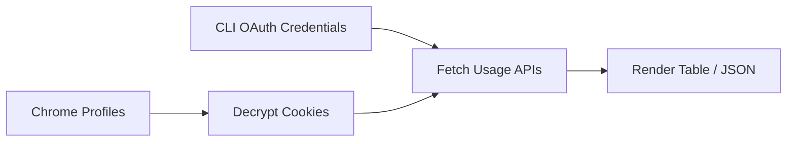

<p align="center">
  
</p>

<h1 align="center">ai-usage</h1>

<p align="center">
  macOS CLI that shows Claude, Codex, Antigravity, PixelLab, and Grok usage limits across all Chrome profiles and CLI OAuth accounts
</p>

<!-- standard:badges:start -->
<h3 align="center">Supported Platforms</h3>

<p align="center">
  
</p>

<p align="center">
  <a href="https://github.com/owayo/ai-usage/actions/workflows/ci.yml"></a>
  <a href="https://github.com/owayo/ai-usage/releases/latest"></a>
  <a href="LICENSE"></a>
</p>

<p align="center">
  <a href="README.md">English</a> |
  <a href="README.ja.md">日本語</a>
</p>
<!-- standard:badges:end -->

---

One command to see usage limits for **Claude**, **OpenAI Codex (ChatGPT)**, **Antigravity**, **PixelLab**, and **Grok**. Browser-backed accounts are collected across every signed-in Chrome profile, while Antigravity and Grok use their CLI OAuth credentials.

It reads each Chrome profile's session straight from the browser, so it can report **multiple accounts at once** (e.g. a `Work` and a `Home` profile, each with both a Claude and a Codex subscription = four accounts) without you logging anything in or out.

## Features

- **Multi-Account**: Reports every Chrome profile signed into Claude, Codex, or PixelLab — no re-login needed. Account labels fall back from the provider email to the Chrome profile email and then the profile name, skipping empty or malformed email values (including missing or duplicate `@` separators)
- **Multi-Provider**: Claude (`claude.ai`), Codex (`chatgpt.com`), Antigravity (Google's `agy` CLI/IDE), PixelLab (`pixellab.ai`), and Grok (xAI's `grok` CLI) in one view
- **Typed Windows**: Each quota carries its real cycle (5-hour, daily, weekly, or monthly) with a usage bar, percentage when available, and reset countdown — each row's badge (`5h` / `1d` / `1w` / `1m`) comes from the quota itself. An unavailable percentage shows `--%` instead of 0%. Any row with only one window collapses both slots into a single wider bar. Older caches without cycle metadata retain provider-appropriate labels and reset-warning thresholds
- **Manual Resets**: Claude and Codex rows show how many manual usage resets remain and when each grant expires — the table and the TUI list every expiry, while the statusline shows the totals and the nearest date. The statusline and the TUI show a date in red once fewer than seven days remain. A count that could not be fetched reads `?` rather than `0`, and expired grants drop out even when rendering an older cache
- **Cloudflare-Safe**: Emulates Chrome's TLS/HTTP2 fingerprint via [`wreq`](https://crates.io/crates/wreq) and replays `cf_clearance` cookies
- **Statusline Mode**: Compact one-line-per-account output with brand logos for terminal status bars. Labels are padded by display width and truncated at grapheme boundaries, preserving emoji and combining characters
- **Interactive Dashboard**: `--tui` groups quotas and manual resets by account, with a disk panel at the bottom showing the startup disk's used, purgeable, and free space. Short terminals show the visible part of each account; reset countdowns of 1–59 seconds show `1m`
- **JSON Output**: Machine-readable output for scripting and dashboards
- **Zero Config**: Auto-discovers all signed-in profiles by default; optional `~/.config/ai-usage/config.toml` for pinning
- **Sort Options**: Rank rows by long-window utilization or reset time (`weekly-*` option names are retained for compatibility)
- **Privacy**: Nothing leaves your machine except authenticated usage requests to the providers listed above

## Requirements

- **Browser**: Google Chrome (signed into Claude, Codex, and/or PixelLab) for browser-backed providers. Chrome is optional if you only use the OAuth-backed providers below — when it is missing, `ai-usage` notes it on stderr and reports the remaining providers
- **Build from source**: Rust and CMake are required for the BoringSSL build inside [`wreq`](https://crates.io/crates/wreq). `make setup` installs the versions pinned in `mise.toml`. A direct `cargo install` needs CMake on `PATH` (for example, `brew install cmake`)
- **Optional**: Antigravity app, `agy` CLI, or `~/.gemini` OAuth token for Antigravity usage. Refreshing a token also needs the app's OAuth client or the environment overrides described in [Architecture](docs/architecture.md)
- **Optional**: `grok` CLI signed in (`~/.grok/auth.json`) for Grok usage

## Installation

<!-- standard:install:start -->
### Homebrew (macOS)

```bash
brew install owayo/ai-usage/ai-usage
```

### Cargo

Requires Rust 1.98 or later.

```bash
cargo install --git https://github.com/owayo/ai-usage --locked
```

### From GitHub Releases

Download the archive for your platform from [Releases](https://github.com/owayo/ai-usage/releases/latest), extract it, and put `ai-usage` on your `PATH`. Each release also includes `SHA256SUMS` for checking the downloads.

| Platform | Archive |
|---|---|
| macOS (Intel) | `ai-usage-x86_64-apple-darwin.tar.gz` |
| macOS (Apple Silicon) | `ai-usage-aarch64-apple-darwin.tar.gz` |

On macOS, if you downloaded the archive with a browser, remove the quarantine attribute before running it: `xattr -d com.apple.quarantine ai-usage`.

### From Source

Requires [mise](https://mise.jdx.dev/) (the Rust toolchain is pinned in `mise.toml`).

```bash
git clone https://github.com/owayo/ai-usage.git
cd ai-usage
make install
```

`make install` installs to `/usr/local/bin`. Set `INSTALL_PATH` to change it (for example `make install INSTALL_PATH="$HOME/.local/bin"`).
<!-- standard:install:end -->

### First run

The first run with a browser-backed provider triggers a macOS Keychain prompt (*"… wants to use the 'Chrome Safe Storage' key"*). Choose **Always Allow**.

## Usage

Usage results are shared between processes for 120 seconds by default. Starting several instances, including different output modes or overlapping `--only` / `--profile` selections, fetches each source once. A cache hit skips API calls and Chrome Keychain access. Use `ai-usage --refresh` to update immediately, or `--cache-ttl 60` to choose a different lifetime. See [shared caching](docs/cli-reference.md#shared-usage-cache).

Run `ai-usage` with no arguments to see every signed-in account:

```text
┌─────────┬──────────┬──────────────────────────┬─────────────────────────────────┬───────────────────────────────────────────────┬───────────────────────────────────────┐
│ Account ┆ Service  ┆ Plan                     ┆ Short window                    ┆ Long window                                   ┆ Manual resets                         │
╞═════════╪══════════╪══════════════════════════╪═════════════════════════════════╪═══════════════════════════════════════════════╪═══════════════════════════════════════╡
│ work    ┆ Claude   ┆ max                      ┆ 5h ░░░░░░░░░░    4%  · in 2h 0m ┆ 1w ░░░░░░░░░░    3%  · in 4d 0h               ┆ full 1 (1@10/23 05:27)                │
│         ┆          ┆                          ┆                                 ┆                                               ┆ 5h 0                                  │
├╌╌╌╌╌╌╌╌╌┼╌╌╌╌╌╌╌╌╌╌┼╌╌╌╌╌╌╌╌╌╌╌╌╌╌╌╌╌╌╌╌╌╌╌╌╌╌┼╌╌╌╌╌╌╌╌╌╌╌╌╌╌╌╌╌╌╌╌╌╌╌╌╌╌╌╌╌╌╌╌╌┼╌╌╌╌╌╌╌╌╌╌╌╌╌╌╌╌╌╌╌╌╌╌╌╌╌╌╌╌╌╌╌╌╌╌╌╌╌╌╌╌╌╌╌╌╌╌╌┼╌╌╌╌╌╌╌╌╌╌╌╌╌╌╌╌╌╌╌╌╌╌╌╌╌╌╌╌╌╌╌╌╌╌╌╌╌╌╌┤
│ work    ┆ Codex    ┆ team                     ┆ 5h ░░░░░░░░░░    1%  · in 5h 0m ┆ 1w ░░░░░░░░░░    0%  · in 6d 23h              ┆ full 2 (1@10/23 05:27, 1@10/30 03:57) │
├╌╌╌╌╌╌╌╌╌┼╌╌╌╌╌╌╌╌╌╌┼╌╌╌╌╌╌╌╌╌╌╌╌╌╌╌╌╌╌╌╌╌╌╌╌╌╌┼╌╌╌╌╌╌╌╌╌╌╌╌╌╌╌╌╌╌╌╌╌╌╌╌╌╌╌╌╌╌╌╌╌┼╌╌╌╌╌╌╌╌╌╌╌╌╌╌╌╌╌╌╌╌╌╌╌╌╌╌╌╌╌╌╌╌╌╌╌╌╌╌╌╌╌╌╌╌╌╌╌┼╌╌╌╌╌╌╌╌╌╌╌╌╌╌╌╌╌╌╌╌╌╌╌╌╌╌╌╌╌╌╌╌╌╌╌╌╌╌╌┤
│ home    ┆ Claude   ┆ max                      ┆ 5h █░░░░░░░░░   12%  · in 1h 0m ┆ 1w ░░░░░░░░░░    3%  · in 5d 0h               ┆ full 0                                │
│         ┆          ┆                          ┆                                 ┆                                               ┆ 5h 0                                  │
├╌╌╌╌╌╌╌╌╌┼╌╌╌╌╌╌╌╌╌╌┼╌╌╌╌╌╌╌╌╌╌╌╌╌╌╌╌╌╌╌╌╌╌╌╌╌╌┼╌╌╌╌╌╌╌╌╌╌╌╌╌╌╌╌╌╌╌╌╌╌╌╌╌╌╌╌╌╌╌╌╌┼╌╌╌╌╌╌╌╌╌╌╌╌╌╌╌╌╌╌╌╌╌╌╌╌╌╌╌╌╌╌╌╌╌╌╌╌╌╌╌╌╌╌╌╌╌╌╌┼╌╌╌╌╌╌╌╌╌╌╌╌╌╌╌╌╌╌╌╌╌╌╌╌╌╌╌╌╌╌╌╌╌╌╌╌╌╌╌┤
│ home    ┆ Codex    ┆ prolite                  ┆ 5h █░░░░░░░░░   10%  · in 4h 0m ┆ 1w ███░░░░░░░   31%  · in 4d 0h               ┆ full 0                                │
├╌╌╌╌╌╌╌╌╌┼╌╌╌╌╌╌╌╌╌╌┼╌╌╌╌╌╌╌╌╌╌╌╌╌╌╌╌╌╌╌╌╌╌╌╌╌╌┼╌╌╌╌╌╌╌╌╌╌╌╌╌╌╌╌╌╌╌╌╌╌╌╌╌╌╌╌╌╌╌╌╌┼╌╌╌╌╌╌╌╌╌╌╌╌╌╌╌╌╌╌╌╌╌╌╌╌╌╌╌╌╌╌╌╌╌╌╌╌╌╌╌╌╌╌╌╌╌╌╌┼╌╌╌╌╌╌╌╌╌╌╌╌╌╌╌╌╌╌╌╌╌╌╌╌╌╌╌╌╌╌╌╌╌╌╌╌╌╌╌┤
│ home    ┆ PixelLab ┆ Tier 1: Pixel Apprentice ┆ —                               ┆ 1m ███████████░░░░░░░░░░░░░   46%  · in 5d 0h ┆ —                                     │
└─────────┴──────────┴──────────────────────────┴─────────────────────────────────┴───────────────────────────────────────────────┴───────────────────────────────────────┘
  updated 21:46 · bars = usage, time = until reset
```

The **Manual resets** column appears when a Claude or Codex row reports them; see [Manual usage resets](docs/cli-reference.md#manual-usage-resets) for the notation.

```bash
# Basic usage
ai-usage                          # all profiles, all providers
ai-usage -p Work,Home             # specific profiles only
ai-usage --list-profiles          # list the Chrome profiles it found

# Filter provider
ai-usage --only claude
ai-usage --only codex
ai-usage --only antigravity
ai-usage --only pixellab
ai-usage --only grok

# JSON output for scripts
ai-usage --json

# Interactive terminal dashboard
ai-usage --tui
ai-usage --tui --only codex
ai-usage --tui --input usage.json  # browse saved JSON

# Statusline for terminal status bar
ai-usage --statusline
ai-usage --statusline --logos --compact --reset-at
ai-usage --statusline --input usage.json --only codex

# Sort by urgency
ai-usage --sort weekly-usage      # closest to the cap first
ai-usage --sort weekly-reset      # soonest reset first
```

The TUI groups quota bars under each account heading, with each window labeled `5h`, `1d`, `1w`, or `1m` and its reset countdown beside it. Elements it shares with the statusline use the statusline's colors. The filled part of each bar and its percentage are green below 60%, yellow from 60%, orange from 80%, and red from 90%, while the unused part and the absolute reset date are dim. The countdown uses the statusline's period-specific thresholds, changing from green through yellow and orange to red as the reset approaches. Manual resets include each grant's expiry, and each expiry date turns red once fewer than seven days remain. `--no-color` turns off colors and bold text. Use `↑` / `↓` or `j` / `k` to scroll, and `q` / `Esc` / `Ctrl+C` to quit. Usage refreshes every minute. `--tui --input <PATH>` rereads the saved `--json` file every minute without network access. When the Grok CLI observed a model-specific free limit rejection within the last 24 hours, the TUI shows its model, observation age, and token counts separately from the weekly credit window. This observation is not a measurement of the current remaining quota.

The TUI also shows each quota window's absolute reset date and time. If a refresh returns fewer accounts, the displayed scroll position stays within the new list. Fetch warnings appear in the dashboard header.

Below the accounts, a disk panel shows the startup disk (for example `Macintosh HD`) followed by any volumes listed in `[tui].disk_mounts`. Each bar splits used (`█`), purgeable (`▒`), and free (`░`) space; available space and the decimal units match Finder. Each volume is reread in the background 30 seconds after its previous read. With `--input`, disk values are still read live from this Mac. Hide the panel with `--no-disk` or by setting `[tui].disk` to `false`. See [Disk usage](docs/architecture.md#disk-usage) for how the values are measured and displayed.

If PixelLab supplies a generation limit but omits the generation count, its monthly window and reset time remain visible with an unknown percentage (`--%`). An explicit zero count still displays `0%`.

Every command and option, including statusline active-row selection, `--input` for fast status-bar redraws from a cached `--json` file, and `--debug`: [docs/cli-reference.md](docs/cli-reference.md)

## Configuration

`ai-usage` needs **no configuration**: it auto-discovers every Chrome profile that has a Claude, Codex, or PixelLab session, plus available Antigravity and Grok OAuth credentials. To pin *which* profiles appear, rename them, or limit providers, put a file at **`~/.config/ai-usage/config.toml`** (or `$XDG_CONFIG_HOME/ai-usage/config.toml`). `--config <PATH>` reads another file instead.

Set `exclude = ["antigravity"]` under `[providers]` to omit a provider from table, JSON, statusline, and TUI output, including cached views. Excluded providers are not fetched; `--only antigravity` temporarily includes one.

Generate a starter config from your current sessions (a template also lives at [`config.example.toml`](config.example.toml)):

```bash
ai-usage --init-config
ai-usage --init-config --config ./config.toml
```

An existing file is kept intact and the generated template is printed to stdout. If Chrome profiles share a display name, the template uses their unique directory names.

A minimal config that shows two profiles under short labels:

```toml
# Listing any [[profiles]] shows ONLY those, in this order.
[[profiles]]
match = "Work"                    # Chrome display name, or on-disk dir e.g. "Default"
label = "work"                    # optional: shown instead of the account email username

[[profiles]]
match = "Home"
label = "home"
```

Precedence: **CLI flags > config file > auto-detection**. The Antigravity, Grok, statusline, and TUI tables and every key with its default: [docs/configuration.md](docs/configuration.md)

## How It Works



For browser-backed profiles, `ai-usage` decrypts Chrome's cookies with the **Chrome Safe Storage** key from your macOS Keychain and calls each provider's usage endpoint. Antigravity and Grok use their CLI OAuth credentials instead. `claude.ai` and `chatgpt.com` sit behind Cloudflare, so the HTTP client ([`wreq`](https://crates.io/crates/wreq)) emulates Chrome's TLS/HTTP2 fingerprint and replays the profile's `cf_clearance` cookie.

Nothing leaves your machine except authenticated usage requests to Anthropic, OpenAI, Google, PixelLab, and xAI. No tokens or cookies are printed or stored.

Per-provider endpoints, cookie handling, and the retry policy: [docs/architecture.md](docs/architecture.md)

## Notes & Limitations

- **macOS + Google Chrome only**. Chrome uses `v10` cookie encryption on macOS; Windows' `v20` app-bound scheme is not handled.
- `--tui` requires an interactive terminal of at least 48 columns × 9 rows. Scrolling moves by account. Enlarge the terminal to see the lower lines of an account taller than the available area. The bordered disk panel needs a terminal at least 14 rows tall (15 while the header shows a warning). Each additional volume needs one more row; volumes that do not fit are summarized as `+N more` in the panel title. At 12–13 rows the panel shrinks to a single line without a border, and on shorter terminals it is hidden so the accounts keep their space.
- Chrome is optional for the OAuth-only providers. When Chrome isn't installed, its `Local State` can't be read, or you decline the Keychain prompt, a normal run prints `skipping Chrome profiles: …` on stderr and still renders Antigravity and Grok. Only `--list-profiles` / `--init-config` fail outright, since Chrome is the whole point of those modes — and when Chrome is the *only* target, the Keychain error is reported verbatim so you know to approve the prompt and re-run.
- An unreadable config falls back to auto-discovery. A missing *default* config is silent, but a `--config` path you passed explicitly is reported on stderr, so a typo doesn't masquerade as "my config is being ignored".
- If a `cf_clearance` cookie has gone stale you'll see a *Cloudflare challenge* error for that one account — open the relevant site once in that Chrome profile to refresh it, then re-run. Other accounts are unaffected.
- Antigravity's grouped weekly quota is served only by the local `language_server`, so Antigravity.app or `agy` has to be running to see both model groups. With just the `~/.gemini` OAuth token, Google may reject `retrieveUserQuota` with a `403`, and the row reads *OAuth token lacks quota permission — open `agy` for full data*.
- The usage endpoints are **undocumented / reverse-engineered** and may change.

## Acknowledgements

**Antigravity** (Google's `agy` CLI / IDE) usage support follows the reverse-engineering in [CodexBar](https://github.com/steipete/CodexBar)'s Antigravity provider — see its [implementation notes](https://github.com/steipete/CodexBar/blob/main/docs/antigravity.md).

## Development

<!-- standard:dev:start -->
Requires [mise](https://mise.jdx.dev/). Tool versions are pinned in `mise.toml`.

```bash
make setup   # Install the toolchain (mise) and dependencies
make ci      # Run the same checks as CI (no changes)
```

| Command | Description |
|---|---|
| `make setup` | Install the toolchain (mise) and dependencies |
| `make build` | Build a debug binary |
| `make release` | Build a release binary |
| `make run` | Run the debug binary (arguments via ARGS="...") |
| `make test` | Run the tests |
| `make lint` | Run clippy with warnings as errors |
| `make fmt` | Format the code (rewrites files) |
| `make fmt-check` | Check the formatting (no changes) |
| `make check` | Run fmt-check and lint (no changes) |
| `make ci` | Run the same checks as CI (no changes) |
| `make install` | Install the release binary to INSTALL_PATH (default /usr/local/bin) |
| `make uninstall` | Remove the binary from INSTALL_PATH |
| `make clean` | Remove build artifacts |

Run `make` to list every target. Releases are published from GitHub Actions (**Actions → Release → Run workflow**).
<!-- standard:dev:end -->

`make setup` installs both Rust and CMake through mise. `make deps` ensures the pinned CMake is available; with `SYSTEM_TOOLS=1`, it uses the CMake on `PATH` or installs it through Homebrew when missing.

The [maintenance review record](docs/maintenance.md) documents confirmed bugs, reproduction conditions, and regression coverage.

## License

<!-- standard:license:start -->
[MIT](LICENSE)
<!-- standard:license:end -->
