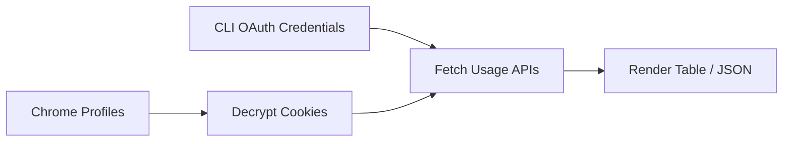

# How it works

For browser-backed profiles and CLI OAuth providers, `ai-usage`:

1. **Decrypts** cookies from `~/Library/Application Support/Google/Chrome/<profile>/Cookies`
   using the **Chrome Safe Storage** key from your macOS Keychain (standard `v10`
   AES‑128‑CBC scheme). The live SQLite database is opened read-only so current,
   uncheckpointed WAL entries remain visible. Only cookies Chrome would send to `claude.ai` / `chatgpt.com` / `www.pixellab.ai`
   themselves are replayed — suffix lookalikes like `evilclaude.ai` are filtered out.
   Chunked session cookies are accepted only when their suffix is numeric (`.0`, `.1`, ...).
2. **Claude** — uses the `sessionKey` cookie to call
   `claude.ai/api/organizations/{org}/usage` → `five_hour` / `seven_day` `{utilization, resets_at}`.
   The same request adds `?cedar_ember=1` to read manual reset grants
   (`cedar_ember.grants[]` with `resets_left`, the windows they `clears`, `ends_at`, and `paused`).
3. **Codex** — uses the `__Secure-next-auth.session-token` cookie to exchange for a Bearer
   token via `chatgpt.com/api/auth/session`, then calls `chatgpt.com/backend-api/wham/usage`
   → `rate_limit.primary_window` / `secondary_window`. Manual reset counts come from
   `wham/rate-limit-reset-credits` (`available_count` and `credits[]`), fetched concurrently
   with a five-second limit; if that side request fails, the usage row stays and the count reads `?`.
4. **Antigravity** — reads the OAuth token from `~/.gemini` (refreshing as needed). When
   Antigravity.app or `agy` is running, it prefers the localhost quota server for the richer
   per-group payload. App/IDE processes are authenticated with the `--csrf_token` value from
   their process arguments; `agy` exposes a tokenless local endpoint. If neither local path is
   usable, it falls back to Google's `cloudcode-pa.googleapis.com/v1internal:retrieveUserQuota`.
   Both nested and flat `remainingFraction` quota shapes are handled when choosing the most
   constrained bucket for display; buckets without a numeric value are skipped. Local grouped
   quotas are labeled `1w` / `5h` from their
   actual window, while the OAuth fallback's daily quota is labeled `1d`.
   Process and listening-port discovery runs asynchronously: each `ps` / `lsof` command
   has a one-second timeout and is terminated on timeout or cancellation. The entire local
   path, including discovery, is capped at five seconds to leave time for the OAuth fallback.
   Token refresh requires Antigravity's OAuth client, discovered from Antigravity.app or
   supplied through `ANTIGRAVITY_OAUTH_CLIENT_ID` and `ANTIGRAVITY_OAUTH_CLIENT_SECRET`.
   An expired token file alone is insufficient when neither source is available.
5. **PixelLab** — reads the `supabase-auth-token` cookie from `www.pixellab.ai` in either
   the legacy URL-encoded JSON-array form or Supabase's `base64-` + unpadded Base64URL
   object form, refreshing
   the access token via `supabase.pixellab.ai/auth/v1/token` if it has expired, then calls
   `api.pixellab.ai/get-account-data` (monthly `imageGenerated / imageAmount` + prepaid
   `credits`) and `api.pixellab.ai/get-subscription` (plan name + `generation_reset_date`).
   The monthly quota renders in the long-window column with a `1m` badge (rather than the
   usual `1w`) so it isn't mistaken for a weekly reset. Since PixelLab has no rolling
   5-hour window, the 5-hour slot is collapsed and the long-window slot expands into a
   wider bar spanning the same total width as the two-slot layout.
6. **Grok** — reads OAuth credentials from `~/.grok/auth.json` (written by `grok login`),
   choosing the newest complete credential by its full RFC 3339 creation time, including
   fractional seconds, when the file contains multiple entries and
   ignoring incomplete entries, then refreshing the access token
   via `auth.x.ai/oauth2/token` (`refresh_token` grant, public
   OAuth client — no secret) when it is about to expire. Calls
   `cli-chat-proxy.grok.com/v1/user?include=subscription` for the plan (`subscriptionTier`
   → falls back to `Free`) and `cli-chat-proxy.grok.com/v1/billing?format=credits` for the
   current credit period. The period type sets the `1w` or `1m` badge and its end sets the
   reset countdown. Only `creditUsagePercent` supplies a usage percentage; when the API omits
   it, the single wide bar shows `--%` rather than an invented 0%. The CLI's model-specific
   free-tier rate limit is separate from this credit period. A model-specific
   free-limit rejection in the CLI log from the last 24 hours adds a separate
   observation with token counts and age. Successful inference logs lack a model
   name, so they cannot safely clear a model-specific rejection. Historical token
   counts are not treated as the current remaining quota.

## Cloudflare and retries

`claude.ai` and `chatgpt.com` sit behind Cloudflare, so the HTTP client ([`wreq`](https://crates.io/crates/wreq)) emulates Chrome's TLS/HTTP2 fingerprint and replays the profile's `cf_clearance` cookie — a plain HTTP client just gets a `403`. Transport failures and HTTP `408` / `429` / `5xx` responses use the same bounded retry policy for GET and POST requests, with a 20-second deadline per provider job. Once a token refresh has been sent for a provider, its remaining failures are *not* retried: ai-usage never writes a rotated refresh token back, so replaying that fetch would resend a token the server may already have rotated away.

## Disk usage

The `--tui` disk panel and `ai-usage --disk` read each volume's capacity locally through Foundation's `NSURL` volume resource values. Nothing is sent over the network. Disk usage is not part of the usage `--json`, the table, `--statusline`, or the shared usage cache; `--disk` prints it separately ([Disk usage output](cli-reference.md#disk-usage-output)).

- **Total**: the volume's total capacity.
- **Available**: the capacity available for important usage. This is the figure Finder reports as available, and it includes purgeable space.
- **Free**: the space that is free right now.
- **Purgeable**: available − free. This is an estimate and is not guaranteed to match Finder's purgeable figure exactly.

Used space is total − available, so the percentage matches how full Finder considers the disk. Volumes that do not report capacity for important usage (for example, some external or Time Machine disks) show available = free and no purgeable part. Sizes use decimal units like Finder (1 GB = 1,000,000,000 bytes). The percentage reads 0% or 100% only when the disk is exactly empty or full.

The startup disk (the volume mounted at `/`) is always the first row, labeled with the volume name macOS reports, such as `Macintosh HD`. Volumes from `[tui].disk_mounts` follow in the listed order. The panel title doubles as the legend: `Disk · █ used ▒ purgeable ░ free`. Each row shows the volume name, a bar, the used percentage, and text such as `70.8 GB available of 494.4 GB · 13.1 GB free · 57.7 GB purgeable`. The used segment and the percentage take their color from the used percentage, using the same four colors as the quota bars: green below 80%, yellow from 80%, orange from 90%, and red from 95%. The percentage is also bold from 90%. The purgeable segment is gray and the free segment is dim. Volume names and the size text are gray, the age of stale values and `reading…` (shown until a volume's first value arrives) are dim, `no response` is yellow, and `unavailable: …` is red. The glyphs keep the segments distinguishable without color, and `--no-color`, `NO_COLOR`, and `TERM=dumb` turn off colors and bold text as elsewhere in the TUI. Narrow terminals keep the bar and shorten the text after it in steps, from the full breakdown down to the available size and finally to the percentage alone.

Reads run on a background thread, so drawing and key handling never wait for them. The first read starts when the TUI opens, and each volume is read again 30 seconds after its previous read finishes, independently of the one-minute usage refresh. At most one read per volume runs at a time. If a read takes longer than 2 seconds, the row shows `no response`, or keeps the last values with their age (for example `· 3m ago`). Quitting never waits for a stuck read. A failed read also keeps the last values with their age. With `--tui --input`, account usage comes from the saved file, but disk values are always read live from this Mac.

`ai-usage --disk` prints the same rows without the dashboard. The bar, percentage, size text, and colors come from the same code as the panel, so the two cannot disagree. Because the terminal width is unknown, `--disk` always uses a 20-cell bar and the most detailed text. It reads each volume once, each on its own background thread, and waits at most 2 seconds for all of them together. A volume that has not answered by then is reported as `no response`, and the process exits without waiting for that read. If reading a volume fails unexpectedly (the reader panics), both the panel and `--disk` report it as a failed read rather than as a read that never returns.

`[tui].disk_mounts` and `--mount` entries are checked against the system mount table before any query, and network volumes are never queried, so an unreachable share cannot stall the TUI or `--disk`. See [Configuration](configuration.md#configuration-options) for what an unmounted or network entry shows.

## Privacy

Nothing leaves your machine except authenticated usage requests to Anthropic, OpenAI, Google, PixelLab, and xAI. No tokens or cookies are printed or stored.
